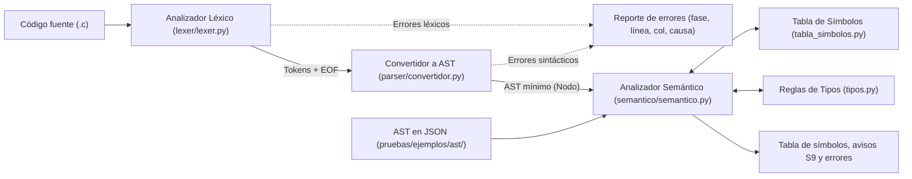
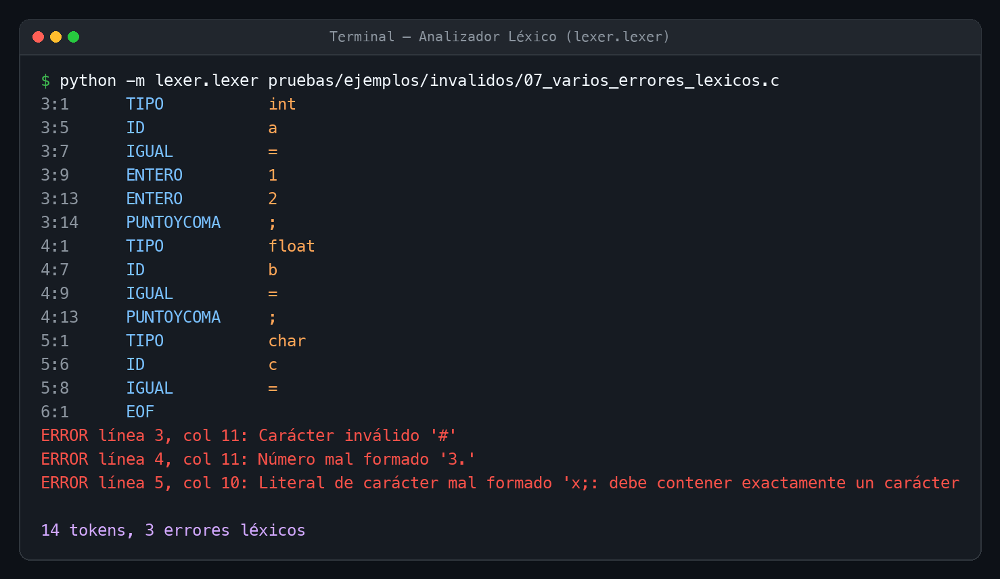
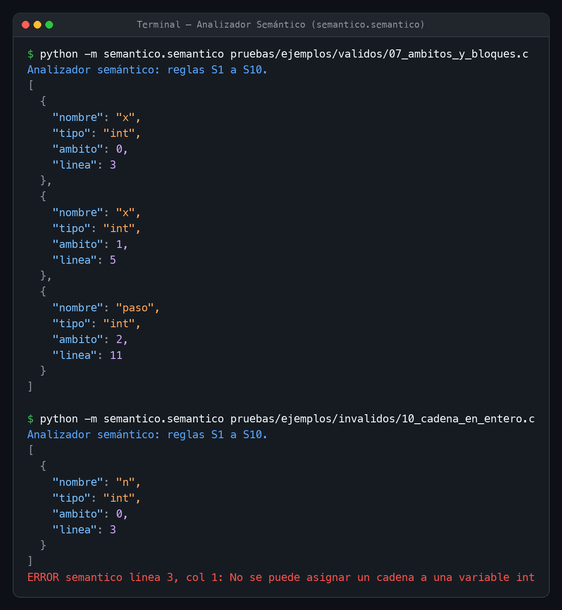
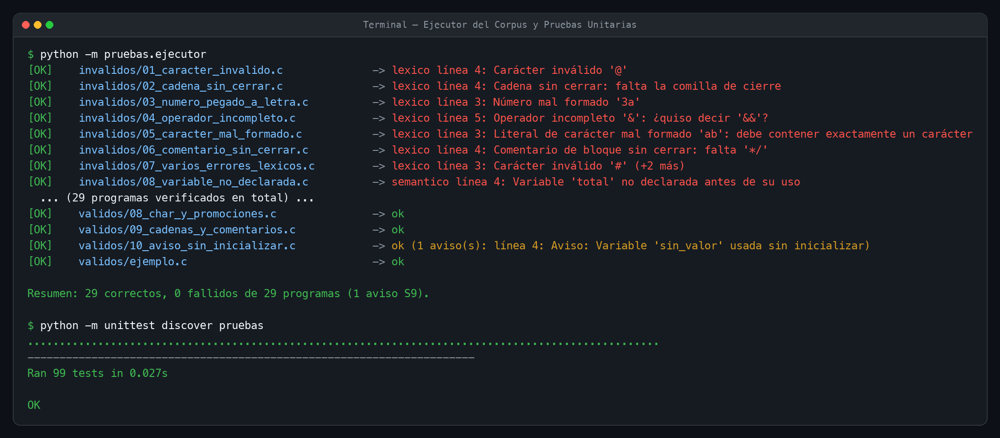

<div align="center">

# Analizador Léxico y Semántico de mini-C

**Teoría de Lenguajes de Programación (TLP02-2026) — Fase 1**


[Arquitectura](#arquitectura-del-compilador) · [Cómo ejecutar](#cómo-ejecutar) · [Casos de prueba](#4-casos-de-prueba) · [Corpus](#corpus-de-pruebas) · [Reflexión CFG](#reflexión-qué-verificaciones-no-puede-expresar-una-cfg) · [Documentación](#documentación)

</div>

---

Analizador léxico y analizador semántico para **mini-C**, un subconjunto de C diseñado para demostrar la separación entre lenguajes regulares (tipo 3), libres de contexto (tipo 2) y verificaciones sensibles al contexto (tipo 1).

```text
int total = base @ 2;   ->  ERROR línea 4, col 18: Carácter inválido '@' (fase léxica)
int n = "hola";         ->  ERROR semantico línea 3, col 1: No se puede asignar un cadena a una variable int
```

## Integrantes

- Fabio Mijango
- Gabriela Sofia Quinteros Ramirez
- Juan Carlos Sibrian
- Kattia Sarai Santan Soriano
- Oscar Ernesto Menjivar Ayala

## El lenguaje

Mini-C cubre un subconjunto de C con:

| Característica | Detalle |
|---|---|
| **Tipos de dato** | `int`, `float`, `char` |
| **Sentencias** | Declaraciones (con o sin inicialización), asignaciones, bloques `{ ... }`, `printf` |
| **Control de flujo** | `if` / `else` y `while` |
| **Operadores** | Aritméticos (`+`, `-`, `*`, `/`, `%`), relacionales (`<`, `>`, `<=`, `>=`, `==`, `!=`) y lógicos (`&&`, `\|\|`, `!`) |
| **Comentarios** | De línea (`// ...`) y de bloque (`/* ... */`) |

Un programa es una secuencia directa de sentencias (sin `main` ni funciones definidas por el usuario). El detalle completo del lenguaje, las **10 reglas semánticas (S1 a S10)** y la especificación formal de tokens están en [docs/lenguaje_c.md](docs/lenguaje_c.md) y [docs/tokens.md](docs/tokens.md).

## Arquitectura del compilador



## Estructura del repositorio

```text
ProyectoTLP2026/
├── lexer/          analizador léxico (lexer.py) y ejemplo de salida JSON
├── parser/         representación AST (nodo.py) y convertidor de tokens a AST (convertidor.py)
├── semantico/      analizador semántico (semantico.py), tabla de símbolos y reglas de tipos
├── pruebas/        ejecutor del corpus (ejecutor.py), pruebas unitarias y programas .c / AST de ejemplo
├── docs/           especificación formal de tokens, definición de mini-C, contratos y capturas (img/)
├── CONTRIBUTING.md guía de estilo y flujo de trabajo en Git
└── README.md
```

## Cómo ejecutar

> [!NOTE]
> **Requisitos:** Python **3.10 o superior**, sin dependencias externas. Todos los comandos se ejecutan desde la raíz del repositorio (usa `python3` en macOS/Linux si `python` no apunta a Python 3).

### 1. Analizador léxico

Recorre el archivo `.c` una sola vez, imprime los tokens reconocidos (`tipo`, `lexema`, `linea`, `columna`) junto con todos los errores léxicos detectados (sin detenerse en el primero) y genera `salida/tokens.txt` y `salida/errores.txt`.

```sh
# Entrada válida
python -m lexer.lexer pruebas/ejemplos/validos/ejemplo.c

# Entrada con múltiples errores léxicos
python -m lexer.lexer pruebas/ejemplos/invalidos/07_varios_errores_lexicos.c

# Exportar los tokens a JSON
python -m lexer.lexer pruebas/ejemplos/validos/ejemplo.c --json salida/tokens.json
```



### 2. Convertidor de tokens a AST

Convierte un programa `.c` en un árbol sintáctico mínimo (`Nodo`) en formato JSON para alimentar al analizador semántico.

```sh
python -m parser.convertidor pruebas/ejemplos/validos/ejemplo.c
```

### 3. Analizador semántico

Recibe un archivo `.c` o un AST en `.json`, construye la tabla de símbolos con manejo de ámbitos anidados y verifica las reglas semánticas **S1 a S10** (declaración previa, redeclaración, compatibilidad y promoción de tipos, condiciones y operadores numéricos, ámbitos por bloque, avisos de variables sin inicializar y uso de cadenas en `printf`).

```sh
# Programas válidos (ámbitos, promociones de tipos y aviso S9 sin inicializar)
python -m semantico.semantico pruebas/ejemplos/validos/07_ambitos_y_bloques.c
python -m semantico.semantico pruebas/ejemplos/validos/08_char_y_promociones.c
python -m semantico.semantico pruebas/ejemplos/validos/10_aviso_sin_inicializar.c

# Programas con errores semánticos (ámbitos y tipos)
python -m semantico.semantico pruebas/ejemplos/invalidos/09_redeclaracion.c
python -m semantico.semantico pruebas/ejemplos/invalidos/15_variable_fuera_de_su_ambito.c
python -m semantico.semantico pruebas/ejemplos/invalidos/10_cadena_en_entero.c
python -m semantico.semantico pruebas/ejemplos/invalidos/11_float_en_int.c
python -m semantico.semantico pruebas/ejemplos/invalidos/16_modulo_con_float.c

# Ejecución directa sobre un AST en JSON
python -m semantico.semantico pruebas/ejemplos/ast/08_variable_no_declarada.json
```



### 4. Casos de prueba

> [!TIP]
> Para verificar todo el proyecto de una sola vez, ejecuta primero el **ejecutor del corpus** y luego la **suite completa de pruebas unitarias**.

#### Ejecutor general del corpus

Recorre los **29 programas `.c`** de `pruebas/ejemplos/` ejecutando el flujo completo (`lexer` → `convertidor` → `semantico`) y verifica que la fase, la línea y la causa reportadas coincidan con el encabezado `// ESPERADO: ...` de cada archivo.

```sh
python -m pruebas.ejecutor
```

#### Pruebas unitarias

Ejecuta las **99 pruebas unitarias** (léxico, AST, convertidor, tabla de símbolos, ámbitos, avisos S9, reglas de tipos y ejecutor del corpus):

```sh
# Suite completa
python -m unittest discover pruebas

# Por módulo
python -m unittest pruebas.test_lexer
python -m unittest pruebas.test_ast pruebas.test_convertidor
python -m unittest pruebas.test_semantico pruebas.test_semantico_s9 pruebas.test_tipos
python -m unittest pruebas.test_ejecutor
```



## Corpus de pruebas

El corpus se ubica en `pruebas/ejemplos/` y se organiza de la siguiente manera:

| Carpeta | Cantidad | Contenido |
|---|---:|---|
| `pruebas/ejemplos/validos/` | 11 | Tipos, aritmética y precedencia, comparaciones, operadores lógicos, `if`/`else`, `while`, ámbitos anidados, promociones de tipos, comentarios y aviso S9 |
| `pruebas/ejemplos/invalidos/` | 18 | 7 programas con errores léxicos y 11 con errores semánticos (reportando fase, línea y causa) |
| `pruebas/ejemplos/ast/` | 9 | Árboles sintácticos de referencia en JSON para probar el analizador semántico directamente |

La primera línea de cada archivo `.c` declara el resultado esperado (`// ESPERADO: ok`, `// ESPERADO: error lexico linea N` o `// ESPERADO: error semantico linea N`). El índice completo se consulta en [pruebas/ejemplos/INDICE.md](pruebas/ejemplos/INDICE.md).

## Reflexión: qué verificaciones no puede expresar una CFG

Una gramática libre de contexto (tipo 2 en la jerarquía de Chomsky) solo describe **en qué orden** pueden aparecer los símbolos de un programa. Sus producciones tienen la forma `A → γ`: el no terminal de la izquierda se reemplaza sin importar qué lo rodea, y la gramática no guarda memoria de lo que ya vio. Por eso sirve para la estructura (sentencias, expresiones, bloques), pero no para reglas que dependen de información que aparece en otra parte del programa.

1. **Declarar antes de usar (S1).** La regla "toda variable usada debe haber sido declarada" exige recordar el conjunto de nombres declarados y compararlo con cada uso. Es la misma situación del lenguaje clásico `{ w c w }`: la segunda `w` debe repetir la primera, y ese lenguaje no es libre de contexto (se demuestra con el lema de bombeo). La gramática acepta `total = a + 1;` con cualquier identificador, exista o no. Ejemplo: [`08_variable_no_declarada.c`](pruebas/ejemplos/invalidos/08_variable_no_declarada.c).
2. **No redeclarar en el mismo ámbito (S2, S8).** Además de recordar nombres, hay que saber en qué bloque estamos y qué se declaró en él. `int a = 1; int a = 2;` tiene una estructura perfectamente válida para la gramática, y lo declarado dentro de un bloque `{ }` no existe fuera de él. Ejemplos: [`09_redeclaracion.c`](pruebas/ejemplos/invalidos/09_redeclaracion.c) y [`15_variable_fuera_de_su_ambito.c`](pruebas/ejemplos/invalidos/15_variable_fuera_de_su_ambito.c).
3. **Compatibilidad de tipos (S3 a S7).** La gramática acepta la forma `tipo ID = expresión;`, pero no sabe que `"hola"` es una cadena y que el destino es un `int`. Para eso hay que calcular el tipo de cada expresión y compararlo con el del destino. Ejemplo: [`10_cadena_en_entero.c`](pruebas/ejemplos/invalidos/10_cadena_en_entero.c).

En los tres casos el programa es **sintácticamente correcto**: la gramática lo acepta y el analizador semántico lo rechaza, con línea y causa.

> [!IMPORTANT]
> **Conclusión.** Estas verificaciones se hacen en el analizador semántico con una **tabla de símbolos**, que funciona como la memoria que a la CFG le falta. Esto conecta con los lenguajes sensibles al contexto (tipo 1), cuyas reglas pueden depender del contexto en que aparece cada símbolo. Un compilador reparte así el trabajo entre los niveles de la jerarquía: lenguajes regulares para el lexer, libres de contexto para el parser y verificaciones sensibles al contexto en la fase semántica.

## Fase 2 · Español (P3)

Si vas a implementar el parser o a conectar el léxico español, empieza por el [README de relevo de P3 a P4](docs/README_fase2.md). Incluye el estado del proyecto, un ejemplo ejecutable y los resultados esperados al integrar los módulos.

La [gramática v1 y la sección del informe](docs/gramatica_espanol.md) incluyen las producciones para P4 y P5, el contrato del árbol y el análisis de los límites de la CFG. El verificador compara el verbo con el núcleo del sujeto y revisa la concordancia nominal en cada frase. Se prueba con árboles construidos según el contrato.

```sh
python -m unittest pruebas.test_concordancia -v
```

## Documentación

- [Especificación formal de tokens](docs/tokens.md): expresiones regulares, autómata numérico y errores léxicos.
- [El lenguaje mini-C](docs/lenguaje_c.md): alcance del lenguaje y reglas semánticas S1 a S10.
- [Contratos entre módulos](docs/contratos.md): formatos de token, error, AST, tabla de símbolos y funciones públicas.
- [Índice del corpus de pruebas](pruebas/ejemplos/INDICE.md): detalle de los 29 programas de prueba.
- [Guía de contribución](CONTRIBUTING.md): flujo de trabajo en Git y convenciones de código.
